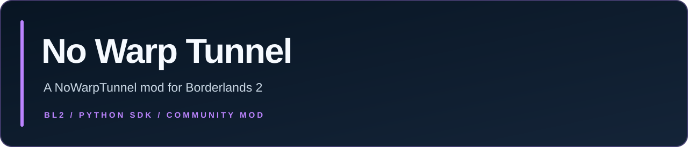

  <a href="#features">Features</a> ·
  <a href="#installation">Installation</a> ·
  <a href="#compatibility">Compatibility</a> ·
  <a href="#documentation">Documentation</a>

---

## Features

- Skips the warp-tunnel presentation during travel in Borderlands 2.
- Works automatically when enabled, without extra settings or keybinds.
- Leaves travel destinations and saved characters unchanged.

## Installation

1. Install [PythonSDK and Willow2 Mod Manager](https://bl-sdk.github.io/willow2-mod-db/).
2. Close Borderlands 2 and back up your existing `sdk_mods/NoWarpTunnel/` folder and saved SDK settings.
3. Download the matching **Player ZIP** from the [Releases page](https://github.com/PeytonBlakeslee/NoWarpTunnel/releases), then extract its `NoWarpTunnel/` folder into `Borderlands 2/sdk_mods/`. Remove duplicate installations.
4. Confirm `sdk_mods/NoWarpTunnel/__init__.py`, then launch the game and enable **No Warp Tunnel** in the SDK Mods menu.

**Download:** Use the matching Player ZIP on the [Releases page](https://github.com/PeytonBlakeslee/NoWarpTunnel/releases). If no public download is listed, publication is still pending. GitHub's automatic source ZIP is not an installable Player package.

See the [user guide](docs/USER_GUIDE.md#install-upgrade-or-remove) for updates, rollback, and troubleshooting.

## Compatibility

**Windows Borderlands 2** is the intended Player target. The Pre-Sequel is experimental; co-op and Proton/Wine are unverified. Native Linux BL2 is unsupported by this package. [Compatibility details](docs/USER_GUIDE.md#compatibility-and-limitations).

## Documentation

[User guide](docs/USER_GUIDE.md) · [Troubleshooting](docs/USER_GUIDE.md#troubleshooting) · [Report an issue](https://github.com/PeytonBlakeslee/NoWarpTunnel/issues) · [MIT license](LICENSE) · [Third-party notices](THIRD_PARTY_NOTICES.md)

---

Other Borderlands 2 mods

- [Auto Pickup](https://github.com/PeytonBlakeslee/AutoPickup)
- [Loot Recovery](https://github.com/PeytonBlakeslee/LootRecovery)
- [Controller Manager](https://github.com/PeytonBlakeslee/ControllerManager)
- [Controller Deadzone Control](https://github.com/PeytonBlakeslee/ControllerDeadzone)
- [OmniMovement](https://github.com/PeytonBlakeslee/OmniMovement)

